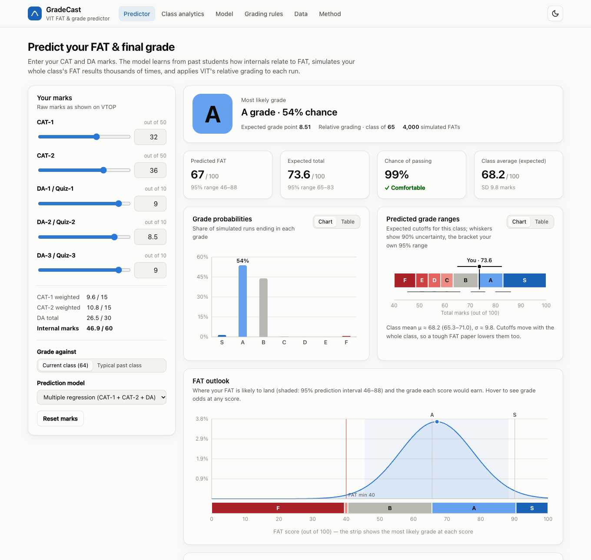
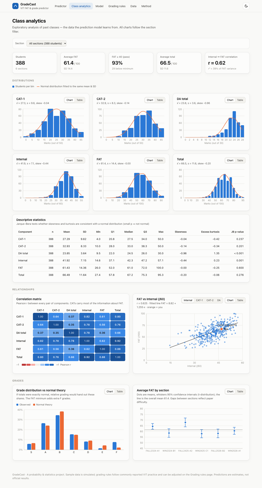
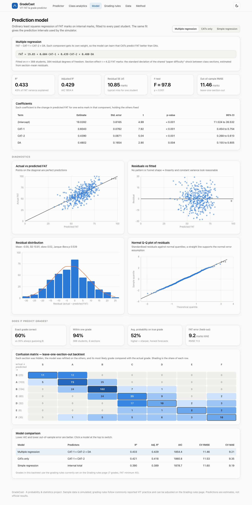

# GradeCast — VIT FAT & Grade Predictor

Predict your **FAT (Final Assessment Test) marks** from your **CAT-1, CAT-2 and DA marks** and estimate your **final grade under VIT's relative grading**. The model learns from past students' marks, simulates the whole class's FAT results thousands of times, and turns the uncertainty into grade probabilities and predicted grade ranges.

> Probability & Statistics lab project · VIT Chennai

**Live app:** _link added after deployment_



---

## Problem statement & scope

A VIT theory course's final grade depends on two unknowns once CAT and DA marks are out:

1. **Your FAT score.** It is worth 40% of the total and has not been written yet.
2. **The grade cutoffs.** Under relative grading these are set from the class's own mean (μ) and standard deviation (σ), which depend on everyone's FAT.

GradeCast estimates both from data and reports them as **probabilities** rather than a single guess.

**In scope:** VIT theory courses (CAT-1, CAT-2, three DAs/quizzes, FAT), relative and absolute grading, uploading your own past/current class data.
**Out of scope:** lab components, attendance debarment, re-FAT and faculty moderation.

## Features

| Page | What it shows |
| --- | --- |
| **Predictor** | Sliders for your marks; predicted FAT with a 95% prediction interval; probability of each grade (S–F); predicted grade ranges (cutoffs) for your class; the FAT score needed for each grade and the chance of reaching it; a FAT-outlook chart showing which grade each FAT score earns |
| **Class analytics** | Histograms with fitted normal curves, descriptive statistics (skewness, kurtosis, Jarque–Bera test), correlation heatmap, scatter plots with least-squares lines, observed vs theoretical grade shares, section means with 95% confidence intervals |
| **Model** | Regression coefficients with SE / t / p / CI, R², adjusted R², F-test, AIC; residual diagnostics (residual plot, histogram, Q-Q plot); leave-one-section-out backtest with a confusion matrix; comparison of three candidate models |
| **Grading rules** | VIT marks scheme, relative-grading rules and their normal-theory shares; histogram of totals coloured by grade; editable rules (k-values, FAT minimum, absolute-grading threshold) |
| **Data** | Upload / download CSVs, templates, data preview |
| **Method** | The full statistical method, assumptions and limitations |

Every chart has a **Chart / Table** toggle, and the app supports **light and dark mode**.

<p>
  
  
</p>

## How it works

### 1. VIT marks scheme (theory course)

| Component | Raw marks | Weightage |
| --- | --- | --- |
| CAT-1 | 50 | 15 |
| CAT-2 | 50 | 15 |
| DA / Quiz (3 × 10) | 30 | 30 |
| FAT | 100 | 40 |

```
Internal = 0.3·CAT1 + 0.3·CAT2 + DA        (out of 60)
Total    = Internal + 0.4·FAT              (out of 100)
```

### 2. Relative grading

With μ and σ the mean and standard deviation of the class's totals:

| Grade | S | A | B | C | D | E | F |
| --- | --- | --- | --- | --- | --- | --- | --- |
| Total ≥ | μ + 1.5σ | μ + 0.5σ | μ − 0.5σ | μ − 1σ | μ − 1.5σ | μ − 2σ | below |
| Grade points | 10 | 9 | 8 | 7 | 6 | 5 | 0 |

A FAT score below **40/100** is an F regardless of the total. Classes of **10 or fewer** students use absolute grading (S ≥ 90, A ≥ 80, B ≥ 70, C ≥ 60, D ≥ 55, E ≥ 50). These are the commonly reported VIT rules, not an official document, so they can all be edited in the app.

### 3. Statistical model

1. **Multiple linear regression** (OLS) of FAT on CAT-1, CAT-2 and DA, fitted on past students:
   `β̂ = (XᵀX)⁻¹Xᵀy`, with standard errors, t-tests, R² and an F-test.
2. **Prediction interval** for a new student:
   `ŷ₀ ± t₀.₉₇₅,ₙ₋ₚ · s·√(1 + x₀ᵀ(XᵀX)⁻¹x₀)`.
3. **Paper-difficulty effect τ.** A random effect shared by every student in a section, estimated by method of moments from section-mean residuals: `τ̂² = max(0, Var(r̄ₛ) − mean(σ²/nₛ))`.
4. **Monte Carlo simulation** (4,000 runs). Each run draws one shared shock δ ~ N(0, τ²) and every classmate's FAT = ŷᵢ + δ + σᵢ·T (Student-t). It then recomputes μ, σ and the cutoffs, and grades everyone. The share of runs ending in each grade estimates the grade probability.
5. **Validation.** Leave-one-section-out backtest: hide a section, refit on the rest, predict its grades from internals only, and compare with the actual grades.

### Results on the bundled (simulated) data

| Metric | Value |
| --- | --- |
| R² (multiple regression) | 0.433 |
| Residual SE | 10.9 FAT marks |
| Out-of-sample FAT RMSE | 11.5 marks |
| Exact grade predicted (held-out sections) | **60%** (baseline of always guessing B: 35%) |
| Within one grade | **94%** |

The regression output is cross-checked against NumPy in [`analysis/verify_with_numpy.py`](analysis/verify_with_numpy.py).

## Tech stack

- **React 19 + TypeScript**, built with **Vite**
- **Recharts** for charts
- A custom statistics engine in TypeScript (`src/lib/`): distributions (normal, t, F, χ²), OLS regression, a seeded RNG and the Monte Carlo simulation. There are no external stats libraries.
- **Vitest** unit tests, checked against textbook and reference values
- Fully client-side: no backend and no data leaves the browser

```
├── data/                      Sample CSVs (simulated)
├── scripts/generate-data.mjs  Reproducible generator for the sample data
├── analysis/                  NumPy cross-check of the regression
├── src/
│   ├── lib/                   Statistics engine
│   │   ├── distributions.ts   Normal, Student-t, F, χ², incomplete beta
│   │   ├── regression.ts      OLS, prediction intervals, cross-validation
│   │   ├── model.ts           Candidate models, section effect τ
│   │   ├── simulation.ts      Monte Carlo class simulation & forecasts
│   │   ├── backtest.ts        Leave-one-section-out grade backtest
│   │   ├── vit.ts             VIT marks scheme & grading rules
│   │   ├── stats.ts           Descriptives, histograms, Q-Q, Jarque–Bera
│   │   ├── random.ts          Seeded RNG (normal, gamma, t)
│   │   └── csv.ts             CSV import/export
│   ├── components/            UI and chart components
│   ├── pages/                 The six pages
│   └── state/AppState.tsx     Shared state & memoised model fits
└── tests/                     Unit tests
```

## Run it locally

**Prerequisites:** Node.js 20.19+ (or 22.12+) and npm.

```bash
git clone <this-repo-url>
cd vit-fat-grade-predictor
npm install
npm run dev          # open the printed http://localhost:5173 URL
```

Other commands:

```bash
npm test             # unit tests
npm run build        # type-check + production build into dist/
npm run preview      # serve the production build
npm run generate-data   # regenerate the simulated sample CSVs
python3 analysis/verify_with_numpy.py   # optional NumPy cross-check (needs numpy)
```

### Environment variables

None. The app is fully static and needs no API keys, secrets or `.env` file.

## Using your own data

On the **Data** page, upload CSVs (templates are downloadable there):

- **Past classes:** `student_id, section, cat1, cat2, da1, da2, da3, fat`
- **Current class (optional):** the same columns without `fat`

`da1–da3` can be replaced by a single `da` column (out of 30). Relative grading is applied per `section`. Files are parsed in the browser and saved only in that browser's local storage.

## Deployment

A GitHub Actions workflow (`.github/workflows/deploy.yml`) runs the tests, builds the app and publishes it to **GitHub Pages** on every push to `main`. Enable it once under *Settings → Pages → Source: GitHub Actions*.

The build uses relative asset paths, so `dist/` can also be deployed as-is to Vercel or Netlify (build command `npm run build`, output directory `dist`).

## Limitations

- The bundled data is **simulated**. It follows realistic distributions and correlations but contains no real student records. Predictions for a real course need real past-class data.
- The model assumes this semester's FAT relates to internal marks the way past FATs did.
- Grading rules come from commonly reported VIT practice. Check your course handbook or faculty.
- These are estimates for planning, not official results.

## License

[MIT](LICENSE)
